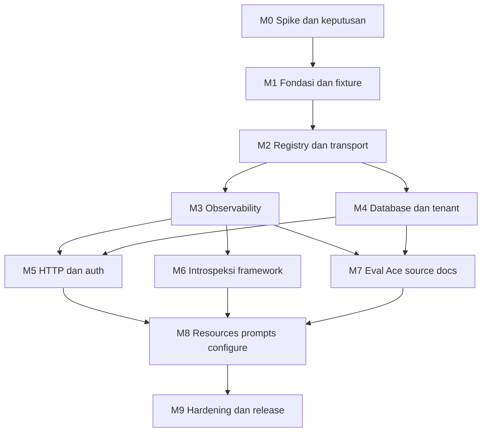

# Implementation Plan — @rikology/adonisjs-mcp

Tanggal: 13 Oktober 2026  
Status: M0 (spike dan obligation ledger) selesai; belum ada implementasi runtime package  
Sumber kebutuhan: [DESIGN.md](./DESIGN.md)  
Obligation ledger: [OBLIGATION_LEDGER.md](./OBLIGATION_LEDGER.md); bukti spike: [spikes/](./spikes/)  
Target deliverable: package npm `@rikology/adonisjs-mcp@0.1.0`, MIT, untuk aplikasi AdonisJS v7 dalam development.

## 1. Baseline, hasil akhir, dan cara memakai rencana

Repository saat penyusunan hanya berisi `docs/DESIGN.md`. Belum ada `package.json`, source package, fixture aplikasi, test runner, CI, atau artefak build. Semua path source, script, dan kontrak implementasi di bawah merupakan **target**, bukan kemampuan yang sudah tersedia.

Setelah M0, repository juga berisi laporan spike `docs/spikes/S-A.md`–`S-K.md`, probe dan raw evidence yang dapat dijalankan ulang di `spikes/`, script fixture `spikes/create-fixtures.sh` dan `spikes/clone-fixture.sh` (aplikasi disposable di `/tmp/adonisjs-mcp-m0`), serta `docs/OBLIGATION_LEDGER.md`. Probe spike bukan source package dan tidak boleh disalin menjadi implementasi tanpa review WP terkait.

Rencana ini mempertahankan cakupan desain: MCP embedded pada proses aplikasi, satu endpoint HTTP, tanpa UI, tool runtime generik dan spesifik AdonisJS, profil API/Inertia/Edge/hybrid, registry ekstensi, tenant awareness, resources, prompts, configure hook, dan skill agent. Seluruh 28 tool yang disebut desain masuk matriks delivery; tool kondisional bukan alasan menghapus implementasinya dari release.

Urutan baca:

1. Bagian 2–4: keputusan, koreksi desain, dan kontrak yang harus dibekukan.
2. Bagian 5: spike untuk asumsi framework yang belum terbukti.
3. Bagian 6–7: milestone, work package, dan dependensi.
4. Bagian 8–10: cakupan fitur, test matrix, dan security invariants.
5. Bagian 11–13: risiko, release, dan pekerjaan pertama.

**Definition of done proyek:** tarball terpasang pada fixture aplikasi bersih; configure dapat dijalankan ulang; client MCP sungguhan membaca state aplikasi yang hidup; seluruh fitur kondisional bekerja pada fixture yang sesuai; production boot tetap berhasil setelah dev dependencies dihilangkan; tidak ada klaim keamanan atau introspeksi yang melampaui bukti.

### Batas cakupan

Dalam cakupan:

- Development lokal; remote development sebagai opt-in berisiko dan terdokumentasi.
- Node.js yang memenuhi minimum AdonisJS v7; ESM TypeScript; Japa; tsdown dan declaration build.
- Tools, resources, prompts, registrasi ekstensi eksplisit, serta dokumentasi client dan agent.
- Adapter untuk paket opsional yang benar-benar dipakai desain; tanpa memuat paket tersebut jika tidak ada.
- SQLite dan PostgreSQL sebagai baseline uji database; dukungan dialect lain hanya boleh diklaim setelah adapter dan gate-nya lulus.

Di luar cakupan release ini:

- Production endpoint, hosted MCP multi-user, OAuth server, atau pengelolaan identitas MCP.
- UI/dashboard, browser automation, stdio yang mem-boot salinan aplikasi, marketplace, auto-discovery plugin.
- Streaming log/subscription jangka panjang, durable task engine, telemetry eksternal, remote documentation search.
- Sandbox aman untuk arbitrary JavaScript, hard timeout kode in-process, atau jaminan rollback semua side effect.
- Menebak schema lengkap dari kode dinamis tanpa bukti, atau mengklaim semua queue/auth/tenant adapter kompatibel.

Pembatasan dialect/adapter adalah batas **klaim kompatibilitas**, bukan penghapusan lima tool database maupun tool opsional dari target implementasi. Perluasan matriks mengikuti bukti, bukan nama package saja.

## 2. Baseline dependency dan fakta eksternal

### 2.1 Hasil verifikasi saat penyusunan

| Komponen | Bukti yang diperiksa | Konsekuensi rencana |
| --- | --- | --- |
| AdonisJS Core | Metadata npm `7.6.0`, engine `node >=24.0.0` [S1] | Node 24 menjadi baseline; range peer awal `^7.0.0` harus diuji pada versi minimum dan versi terkini sebelum diklaim |
| Lucid | Metadata npm `22.4.2`, engine Node 24, peer Core v7 [S2] | Lucid `^22.0.0` optional peer; impor lazy; test kompatibilitas minimum/current |
| MCP SDK v1 | Metadata `@modelcontextprotocol/sdk@1.32.1`; Zod `^3.25` atau `^4.0`; README menyatakan maintenance line [S3][S4] | Klaim desain “SDK v1 hanya Zod v3, pin ^3.23” tidak dipakai |
| MCP SDK v2 | `@modelcontextprotocol/server@2.3.1`, dependency Zod `^4.2.0` [S5] | Pilih v2 untuk proyek baru; gunakan schema object, bukan menyalin raw-shape API v1 |
| Node adapter MCP | `@modelcontextprotocol/node@2.1.1`, peer server `^2.3.0` [S6] | Versi package adapter dan server tidak harus identik; lock tuple yang benar-benar kompatibel |
| HTTP SDK v2 | `createMcpHandler(factory)` mendukung modern protocol dan legacy stateless; Node bridge `toNodeHandler` [S7][S8] | Jadikan ini kandidat utama spike transport; jangan merakit protokol sendiri |
| MCP protocol | Revisi `2026-07-28` memakai metadata per request; berbeda dari handshake revisi 2025 [S9][S10] | Test kedua era; upgrade dependency tidak otomatis mengaktifkan protokol modern |
| Provider AdonisJS | `register → boot → start → preload → ready`; environment `web` adalah jenis proses [S11] | Jangan membaca route final saat boot, atau menganggap `web` berarti development |

Metadata registry dan dokumentasi bukan bukti integrasi runtime. Exact lockfile, import API, bodyparser bridge, dan perilaku client harus dibuktikan pada M0–M2. Versi di atas adalah snapshot, bukan instruksi memakai `latest` pada setiap build.

### 2.2 Pilihan implementasi awal

- Runtime dependencies: `@modelcontextprotocol/server`, `@modelcontextprotocol/node`, `zod`; dependency tambahan hanya jika spike membuktikan kebutuhan dan alasan dicatat.
- Dev dependency MCP client untuk smoke/protocol tests; jangan kirim client SDK dalam runtime package.
- Core required peer; Lucid, auth, Inertia, Edge, Tuyau, tenant, permission, dan queue memakai optional integration sesuai API yang diverifikasi. Paket yang diimpor langsung harus dideklarasikan langsung, tidak mengandalkan dependency transitif.
- Lock package manager npm untuk single-package repository, satu `package-lock.json`; fixture memakai tarball lokal, bukan workspace alias yang menutupi masalah publish.
- Runtime package tidak menambahkan framework HTTP kedua. Node adapter boleh membawa dependency transitifnya; Adonis tetap pemilik port dan lifecycle.
- Lisensi package MIT; inventaris lisensi dependency SDK v2 yang berbeda disertakan saat review distribusi.

### 2.3 Tuple yang terverifikasi M0

Diamati pada fixture create-adonisjs 3.4.0 (kit API, Inertia React, hypermedia), Node 24.21.0, npm 11.19.0, macOS 27 arm64. Ini tuple bukti spike, belum matriks kompatibilitas release (Linux, Node minimum, dan Core/Lucid minimum tetap kewajiban WP-38).

| Area | Versi teramati | Spike |
| --- | --- | --- |
| Core / application / http-server / bodyparser / Shield | 7.6.0 / 9.1.0 / 9.3.1 / 11.0.4 / 9.0.0 | S-A, S-B |
| fold / events / logger / ace / assembler / hot-hook / ts-exec | 11.1.0 / 10.2.0 / 7.1.1 / 14.1.1 / 8.5.2 / 1.0.0 / 1.5.0 | S-C, S-D, S-J |
| Lucid / Knex / pg / better-sqlite3 / PostgreSQL | 22.4.2 / 3.3.0 / 8.16.3 / 13.0.3 / 18.4 | S-G, S-H |
| auth / session / Inertia / Vine / Tuyau / Edge / http-transformers / TypeScript | 10.1.0 / 8.1.0 / 5.0.1 / 4.4.0 / 1.2.2 / 6.5.1 / 2.3.1 / 6.0.3 | S-F, S-I |
| MCP server / node adapter / client / Zod | 2.3.1 / 2.1.1 / 2.3.1 / 4.6.7 — tuple kompatibel tanpa override | S-A |
| Tenant / permissions / Bouncer / queue / boringnode queue | `@rikology/adonisjs-tenant` 1.0.2 / `@adonisplus/permissions` 0.0.4 / 4.0.1 / `@adonisjs/queue` 0.6.2 / 0.6.0 | S-H, S-K |
| Parser SQL (kandidat) | `pgsql-ast-parser` 12.0.1, `sqlite-parser` 1.0.1 | S-G |

## 3. Keputusan dan koreksi eksplisit terhadap desain

Bagian ini adalah keputusan awal rencana, **bukan persetujuan pengguna yang sudah diperoleh**. `DESIGN.md` tetap sumber kebutuhan asli dan tidak diubah diam-diam. Jika spike memaksa perubahan kontrak publik, perbarui bagian ini sebelum implementasi konsumen.

| ID | Ketegangan/asumsi dalam desain | Keputusan implementasi |
| --- | --- | --- |
| D01 | Satu `McpServer` saat boot bertentangan dengan server per request | Registry, buffers, dan cache dimiliki aplikasi; `McpServer` dibuat per request oleh factory. HTTP handler bersama ditutup saat shutdown, bukan setiap response |
| D02 | Contoh SDK v1 dan Zod v3 sudah tertinggal | Baseline SDK v2 + Zod v4; factory dual-era dari SDK. Tidak membuat compatibility shim API v1 milik package |
| D03 | Default path `/tidewave/mcp` bertentangan dengan contoh | Satu default `/__adonis/mcp`; identitas client `adonis`; tidak menyediakan alias Tidewave |
| D04 | `devDependencies` + provider environment `web` dianggap cukup untuk production | Uji production install tanpa package. Conditional provider loading **dan** config import harus aman; `app.inDev` juga diperiksa sebagai defense-in-depth |
| D05 | `request.ip()` dapat dipengaruhi trusted proxy | Gunakan socket remote address; validasi Host dan Origin secara terpisah; jangan percaya forwarded headers untuk otorisasi |
| D06 | `Origin: null` dianggap aman | Origin tidak ada diterima untuk native MCP client; literal `null`, malformed, opaque, dan foreign origin ditolak secara default |
| D07 | `allowRemoteAccess` melewati semua proteksi | Flag hanya membuka pembatasan peer address; Host/Origin tetap exact allowlist. Tunnel/proxy tidak boleh membuat endpoint terbuka ke jaringan tak tepercaya |
| D08 | `AbortSignal.timeout` dianggap dapat menghentikan arbitrary eval | Timeout eval kooperatif/batas menunggu, bukan preemption. Kode sinkron dapat membekukan app; side effect yang sudah berjalan tidak otomatis batal |
| D09 | `AsyncFunction` + app root dianggap otomatis menyelesaikan `import('#models/user')` | Natural dynamic import adalah acceptance requirement yang harus dibuktikan; `process.chdir` atau regex rewrite bukan solusi resolver |
| D10 | Prefix `SELECT/WITH/EXPLAIN/PRAGMA` dianggap menjamin read-only | Enforce batas baca di database/connection; pembatas statement hanya lapisan tambahan. Tolak operasi yang tidak bisa dibuktikan aman; tanpa fallback diam-diam ke read-write |
| D11 | Kehadiran `WHERE tenant_id` dianggap menjamin isolasi | Tidak memakai string matching sebagai tenant enforcement. Raw SQL tenant memerlukan boundary DB yang terbukti; jika tidak ada, default tolak dan arahkan ke `query_model` |
| D12 | Tenant AsyncLocalStorage dianggap terbawa lewat HTTP loopback | `http_request` harus masuk lewat middleware tenant aplikasi dengan host/header mapping yang dipercaya; ALS caller tidak menyeberangi socket |
| D13 | Semua metadata diklaim berasal dari runtime | Pisahkan `runtime`, `generated`, dan `source` evidence. Pemetaan Inertia, transformer, Vine, dan Tuyau tidak boleh dipresentasikan sebagai observasi request bila hanya analisis file |
| D14 | Inertia terpasang + Edge tersedia berarti hybrid | Kehadiran package hanya sinyal. Hybrid berarti beberapa surface yang dikonfigurasi/teramati; dependency Edge transitif tidak cukup |
| D15 | Daftar binding pasti memiliki provider asal | Keluarkan origin hanya bila framework mengekspos bukti; selain itu `unknown`. Jangan membuat provenance palsu |
| D16 | Optional peer mengimpor `defineTool` tetapi diklaim type-only | Package ekstensi boleh memberi object yang memenuhi exported type tanpa runtime import; jika memakai helper, lazy import sesudah guard MCP tersedia |
| D17 | Token auth “sementara di memori” berlaku untuk semua guard | Guard dapat menulis token/session ke store. Buat kredensial sementara lewat API nyata, cleanup di `finally`, dan buktikan tidak ada residu |
| D18 | SQL read-only bisa `false`, tetapi skill menyebut selalu read-only | Default read-only. Opt-in write mode ditandai jelas sebagai mutating; skill dan annotations tidak boleh mengklaim aman setelah diubah |
| D19 | Full code eval masuk log buffer | Audit event menyimpan status, durasi, call ID, dan excerpt ter-redaksi; kode penuh/secret tidak disimpan otomatis |
| D20 | `tools.docs.include` berbeda antara contoh dan tabel | Default `['@adonisjs/*', '@rikology/*']`; user dapat mempersempit. Semua config contoh dan stub harus identik semantiknya |

Tidak adanya auth MCP adalah keputusan trust model lokal, bukan bukti bahwa localhost aman dari semua proses/browser. Origin guard tidak mengautentikasi proses lokal. Pengguna yang menyalakan remote access harus menyediakan boundary jaringan tepercaya di luar package.

### 3.1 Keputusan hasil M0

Keputusan berikut berasal dari bukti spike dan memperbarui baris D01–D20 yang disebut. Statusnya sama dengan tabel di atas: keputusan rencana, belum persetujuan pengguna — kecuali D26, yang disetujui pengguna pada 13 Oktober 2026 (ledger B-01, opsi a).

| ID | Bukti | Keputusan | Mengubah |
| --- | --- | --- | --- |
| D21 | S-B | Install production-safe: rc entry `{ file: () => import('#providers/mcp_dev_provider'), environment: ['web'] }` lewat `rcFile.addProvider`; wrapper app-local meng-import provider package hanya bila `app.inDev`; `config/mcp.ts` memakai `import type { McpConfig }` + `satisfies McpConfig` dan provider melakukan default/validation. Strategi desain (provider package langsung + `defineConfig` runtime di config) membuat production `migration:status` dan boot gagal setelah `npm ci --omit=dev`. Release gate memakai deployment standalone di luar ancestor `node_modules` karena build bersarang memberi false positive | D04, API `defineConfig` di config stub |
| D22 | S-B (turunan) | Semua file app yang dimuat di production (config, logger, exception handler, definisi `extraTools`) tidak boleh meng-import package MCP atau `zod` saat runtime; bentuk lazy `extraTools` dibuktikan di WP-03 | D16, `extraTools` desain |
| D23 | S-A | Satu `createMcpHandler(factory)` + `toNodeHandler` per app, ditutup lewat `app.terminating`; route memanggil `relayHeaders()` lalu `await bridge(req, res, ctx.request.body())` tanpa payload lain. Shield `csrf.exceptRoutes` exact path; middleware app yang mengubah `Accept` dikecualikan exact path; limit 1 MiB ditegakkan endpoint; malformed JSON ditolak bodyparser (400) sehingga normalisasi/redaction milik package. Era modern `2026-07-28` dan legacy `2025-11-25` lulus dengan client resmi | D01, D02, CF payload |
| D24 | S-C | Capture log/exception adalah instrumentasi opt-in yang dibuat configure: `hooks.streamWrite` pada logger config dan observer sekali di `HttpExceptionHandler.handle`, lewat gateway app-local dev-guarded yang lolos production prune. Tidak diklaim zero-config; Core 7.6 tidak punya observer publik untuk record log atau error+ctx | Prinsip desain "tanpa instrumentasi" |
| D25 | S-D | `get_container_bindings` = inventory parsial: baseline augmentasi `ContainerBindings` + `hasBinding` tanpa instantiate; observasi awal opt-in di posisi provider pertama dengan origin dari trace `providerRegister`; coverage dan origin `unknown` eksplisit. `get_events` hanya persistent listeners. Controller hot-swap terjadi tanpa restart, sehingga cache tidak boleh hanya diinvalidasi saat `ready` | D15 |
| D26 | S-E; keputusan pengguna B-01 | Evaluator `vm` dengan `importModuleDynamically` callback ke importer framework (`app.import`) dan filename sintetis di app root; satu-satunya mekanisme teramati yang menyelesaikan fresh import controller/service dan identitas hot-swap. **Disetujui:** `--experimental-vm-modules` wajib pada proses dev; configure menawarkan penambahannya (mis. `NODE_OPTIONS` pada script `dev`) dengan konfirmasi, tidak diam-diam; tanpa flag tool mengembalikan `CAPABILITY_UNSUPPORTED` + remediasi. `AsyncFunction` dari package referrer dan main-context default loader gagal. D08 terkonfirmasi: mutation tetap terjadi setelah timeout, loop sinkron membekukan HTTP | D09 (mekanisme; sintaks natural tetap) |
| D27 | S-F | Impersonation: access token dibuat lewat provider nyata (tenant-bound bila tenant aktif) dan dihapus di `finally`; cookie session dicetak sebagai payload terenkripsi ber-expiry terikat deadline call, response cookie di-rewrap, jar dibuang. Semantik = tanpa residu server + replay window terbatas, bukan revocation instan. Guard/user/tenant divalidasi sebelum mint; store session stateful belum didukung sampai dibuktikan | D17 |
| D28 | S-G | Executor SQL milik MCP, tidak menyentuh pool app. PostgreSQL: reader dedicated least-privilege, `queryMode: 'extended'` untuk setiap statement, `BEGIN READ ONLY`, AST single SELECT/WITH dengan fungsi default-deny (allowlist fungsi pure direview di WP-16), deadline via `pg_cancel_backend` dari control connection, `ROLLBACK` + `DISCARD ALL`. Tanpa reader terkonfigurasi, capability nonaktif dengan alasan. SQLite: child process `readonly` + `fileMustExist`, `stmt.readonly` + AST, deny ATTACH/VACUUM/PRAGMA/extension, deadline SIGKILL; in-memory tidak didukung. Prefix filter putaran 1 terbukti bisa dibobol (`COMMIT; DELETE` menghapus data) | D10, D18, CF SQL |
| D29 | S-H | Raw SQL tenant: shared-table tanpa RLS ditolak; dengan FORCE RLS milik host + reader NOBYPASSRLS, MCP sendiri menetapkan `set_config('app.tenant_id', $1, true)` parameterized lalu menjalankan recipe D28. Executor package tenant tidak dipakai di pool app. Tenant di-lookup/diotorisasi sebelum `TenantService.run`; HTTP memakai mapping Host/header tepercaya ke middleware tenant sebelum auth. Schema/database-per-tenant belum didukung | D11, D12 |
| D30 | S-I | Sumber evidence: Vine compiled AST sebagai authority (JSON Schema Vine 4.4.0 salah untuk nullable-required); Tuyau runtime hanya route, shape bersifat type-only; Inertia route/page/shared keys dari TypeScript AST terbatas (compiler milik app); Edge dari mounted roots + scan realpath terbatas. Dynamic case `unknown` | D13, D14 |
| D31 | S-J | Ace lewat subprocess `spawn(process.execPath, ['ace.js', ...], { cwd: appRoot, shell: false })`, stdin tertutup, process group + watchdog independen parent (assembler 8.5.2 mengirim SIGKILL ke HTTP child saat restart). Hard restart = outcome unknown, tanpa auto-retry. In-process `ace.exec` ditolak karena stdout/env bocor antar request | CF Ace |
| D32 | S-K | Paket konkret: tenant `@rikology/adonisjs-tenant` 1.0.2 (`tenant.service`, `TenantService.run`/`runWithTenant`); permission `@adonisplus/permissions` 0.0.4 dari registry privat Plus (modul `#start/permissions`); Bouncer 4 adapter alternatif eksplisit; queue `@adonisjs/queue` 0.6.2 + `@boringnode/queue` 0.6.0 dengan listing via `queue.locations` mengikuti semantik loader | Nama paket di desain |
| D33 | S-G, S-I | Dependency tambahan beralasan: parser SQL dialect-aware (kandidat `pgsql-ast-parser`; `sqlite-parser` 1.0.1 berumur dan perlu evaluasi ulang di WP-16) dan TypeScript compiler yang di-resolve dari app (optional) untuk ekstraksi source | §2.2 |

## 4. Arsitektur dan kontrak yang dibekukan sebelum ekspansi fitur

### 4.1 Ownership modul

| Modul target | Tanggung jawab | Batas impor dan lifecycle |
| --- | --- | --- |
| `index.ts`, `src/types.ts`, `src/define_config.ts`, `src/define_tool.ts` | Public API, config resolution, typed definition | Tidak mengimpor optional runtime package secara eager |
| `providers/mcp_provider.ts` | Dev gate, register service, route, startup/shutdown | Tidak mengandung logika query/tool; tidak membuka port sendiri |
| `src/registry.ts` | Tool/resource/prompt/extension definitions | Tidak memiliki transport/session; satu registry per app |
| `src/server.ts`, `src/handler.ts` | Server factory dan Adonis–SDK bridge | Satu factory snapshot per request, shutdown handler dimiliki provider |
| `src/guards/` | Peer address, Host, Origin, recursion guard | Dieksekusi sebelum handler/tool; tidak bergantung pada auth aplikasi |
| `src/profile.ts` | Capability detection dan surface metadata | Resolusi lazy setelah boot/preloads; availability dan diagnostics eksplisit |
| `src/buffers/` | Ring buffer log dan exception | Batas count dan bytes; attach/detach idempotent; tidak mengganti logger aplikasi |
| `src/tools/{runtime,http,database,app,inertia,api,edge,auth}/` | Implementasi 28 tool | Menggunakan services/adapters bersama, bukan instance MCP langsung |
| `src/adapters/`, `src/tenant.ts` | Seam framework yang terbukti perlu | Modul konkret per integrasi; bukan generic plugin framework kedua |
| `src/resources/`, `src/prompts/` | Read-only projections dan prompt templates | Reuse service yang sama dengan tools; tidak menggandakan query/redaction |
| `configure.ts`, `stubs/`, `skills/adonisjs-mcp/` | Installation experience | Satu sumber skill; stub distribusi dihasilkan dari sumber itu saat build |
| `tests/`, `tests/fixtures/`, `bin/test.ts` | Contract, integration, live HTTP fixture | Semua state sementara; dilarang memakai database development pengguna |

### 4.2 Lifecycle

1. **Register:** bila dev/aktif, register `mcp.registry` dan dependency factories; tanpa I/O atau model import. Binding augmentation tersedia melalui export tipe.
2. **Boot/start:** resolve config, tambah builtin definitions, dan register route sebelum router commit. Package lain boleh register saat `boot()`; urutan provider tidak boleh menentukan apakah builtin terhapus/terduplikasi.
3. **Ready/lazy first call:** ambil profile dari app yang sudah siap, attach listener yang memerlukan server aktif, finalisasi immutable registry snapshot. Development inspection/codegen tidak boleh memulai watcher atau worker.
4. **Per request:** guards → body/protocol validation → factory server → registry snapshot → validated handler → bounded/redacted result. Versi protokol dan status JSON-RPC dikelola SDK.
5. **Shutdown/HMR:** detach listener dan watcher, tutup handler-owned resources, batalkan operasi yang mendukung signal, kosongkan buffer/cache milik instance. Tidak menutup DB pool, logger, atau server milik aplikasi.

Registrasi setelah registry difinalisasi ditolak dengan pesan yang jelas. HMR rebuild registry secara atomik; request yang sedang berlangsung menyelesaikan snapshot lama tanpa menerima setengah definisi baru. Bila framework melakukan process restart, manfaatkan restart tersebut; jangan menambahkan cache-busting ESM import yang menumbuhkan memori tanpa batas.

### 4.3 Public API dan hasil tool

Kontrak yang harus ditetapkan pada M1–M2:

- `defineConfig`: input parsial typed → config resolved tervalidasi, merge nested values konsisten; `projectEval: false` dan `tools.disabled` tetap berlaku.
- `defineTool`: schema object Zod v4, nama snake_case yang konsisten, deskripsi menyebut running AdonisJS app, inferred input tanpa `any` pada API publik.
- `ToolContext`: `app`, resolved config/profile, log/exception services, `callId`, cancellation signal, dan tenant context per panggilan; tidak menyimpan credential HTTP pada singleton.
- `available(ctx)`: capability metadata dihitung dari package **dan** binding aktif; dependency absen berbeda dari integrasi rusak. Integrasi rusak menghasilkan diagnostic, bukan seolah package tidak terpasang.
- `registry.tool/resource/prompt`: tabrakan identitas gagal sebelum serving; `disable(name)` adalah deny-set independen urutan register.
- `registry.extend`: urutan wrapper eksplisit, sekali per call, `next` tidak boleh dipanggil berulang; exception tetap melewati normalisasi/redaction.
- Result sukses: MCP text content yang berisi JSON terstruktur untuk data; eval boleh memiliki display `util.inspect` untuk BigInt/Map/model. Sertakan metadata `durationMs`, `truncated`, serta evidence/limitations bila relevan.
- Result gagal pada eksekusi tool: `isError: true`, stable code, pesan ter-redaksi, detail aman. Error protokol/malformed input tetap milik SDK, tidak diubah seluruhnya menjadi HTTP 200.
- Annotations `readOnlyHint`, `destructiveHint`, `idempotentHint`, `openWorldHint` sesuai perilaku aktual. Annotation bukan enforcement; `project_eval`, `run_ace_command`, `http_request`, dan `render_view` dapat memiliki side effect.
- Stable tool error codes minimum: `DEPENDENCY_UNAVAILABLE`, `CAPABILITY_UNSUPPORTED`, `INPUT_INVALID`, `NOT_FOUND`, `READ_ONLY_VIOLATION`, `TENANT_SCOPE_REQUIRED`, `TIMEOUT`, `CANCELLED`, `EXECUTION_FAILED`.

Resource yang tidak tersedia mengikuti resource error contract SDK. Prompt hanya menyusun instruksi/messages; `prompts/get` tidak menjalankan eval, query, atau HTTP request diam-diam.

### 4.4 Default operasional yang diusulkan

Nilai berikut perlu diwujudkan sebagai typed config, tests boundary, dan dokumentasi yang sama; bukan angka benchmark yang sudah terbukti.

| Area | Default / batas awal |
| --- | --- |
| Endpoint | `/__adonis/mcp`, aktif hanya dev, remote access `false` |
| Network allowlist | Peer `127.0.0.1`, `::1`, mapped loopback; Host localhost/loopback dengan actual listening port; Origin lokal exact-origin saja, tanpa literal `null` |
| Eval | timeout default dan maksimum default 30.000 ms; user config boleh mengubah batas; request tidak boleh melebihi config |
| SQL/model | `readOnly: true`, `maxRows: 100`, `allowCrossTenant: false`; nama connection harus ada pada config aplikasi |
| Logs/exceptions | 1.000 log / 100 exception; byte budget juga dibatasi; default tail log 100 |
| HTTP/Ace | deadline default 30.000 ms; output dibatasi; tidak ada automatic retry operasi mutating |
| Payload/output | request maksimum 1 MiB, result maksimum 256 KiB; pemotongan mempertahankan JSON valid dan menandai truncation |
| Documentation | include dua scope pada D20; maksimum 5 snippet, file/line references, cache lazy |
| Ekstensi | `extraTools: []`, `tools.disabled: []`; mutating tool dapat dimatikan melalui deny-set |

Config tambahan seperti `allowedHosts`, `allowedOrigins`, mapping surface/tenant, dan byte limits harus minimal dan terdokumentasi. Tidak ada wildcard allowlist jaringan bawaan. Ring buffer tidak boleh tumbuh karena satu entry sangat besar.

### 4.5 Profile dan evidence

`ProjectProfile` perlu memperluas bentuk desain dengan:

- `kind`, optional Inertia adapter/SSR, `surfaces`, nullable default guard, installed/active packages, generated artifacts.
- Daftar capability dengan alasan enabled/disabled/unsupported, agar agent tahu mengapa tool tidak muncul.
- Source evidence untuk inferensi surface; `unknown` jika belum dapat ditentukan.
- Surface `web` juga menyimpan renderer `inertia` atau `edge`; web tidak selalu berarti mengirim `X-Inertia`.

Precedence `http_request`: explicit `surface` → explicit `as.guard` yang valid → route metadata yang terbukti → mapping config → inferensi prefix/domain → configured default. Input eksplisit yang konflik harus ditolak, bukan dipilih diam-diam. Matching mempertimbangkan method, domain, dynamic params, dan urutan router; bukan sekadar `startsWith('/api')`.

## 5. M0 — spike dan obligation ledger

Spike harus memakai aplikasi AdonisJS nyata yang dapat dibuang. Bukti minimum: versi dependency, command/scenario, hasil teramati, API/source reference, limitation, serta keputusan pass/fail. Saat dokumen disusun, semua spike **belum dijalankan**; hasil eksekusi 13 Oktober 2026 ada di 5.1.

| ID | Pertanyaan dan eksperimen | Lulus bila | Bila gagal / dampak |
| --- | --- | --- | --- |
| S-A | Pasang SDK v2 factory/Node adapter di route Adonis dengan bodyparser dan Shield aktif; jalankan modern + legacy client | Tools/list dan call memberi satu response; notifications benar; tidak ada body dibaca dua kali, double-send, atau CSRF redirect | Pilih parsed-body bridge yang didukung SDK atau pengecualian bodyparser khusus path; jangan mematikan bodyparser/Shield global. Memblokir M2 |
| S-B | Build fixture, hilangkan dev dependencies, boot production web dan Ace | Tidak ada import package/config yang gagal, tidak ada route/buffer MCP, aplikasi normal tetap jalan | Ubah conditional provider loader dan config stub; environment `web` saja tidak diterima. Memblokir release |
| S-C | Tulis log root/child logger dan exception yang ditangani custom handler; request konkuren | Log normal tetap keluar sekali, buffer berisi event benar, exception tidak tergandakan, detach berhasil | Gunakan extension point yang terdokumentasi; jika tidak ada, catat kebutuhan upstream/opt-in instrumentation dan jangan klaim zero-config sudah tercapai |
| S-D | Inspect routes/middleware/container/events sesudah preload dan setelah HMR | Data sesuai runtime, private/unknown metadata diberi label, route commit tidak terlambat | Adapter versi-terikat dengan tests atau keluaran partial eksplisit; provenance yang tidak tersedia tetap unknown |
| S-E | Eval natural `await import('#models/user')`, resolve service, return BigInt, async delay, synchronous blocking di child fixture | Alias merujuk module instance app yang sama; console terisolasi; cooperative timeout tidak diklaim hard kill | Pakai evaluator/repl resolver framework yang nyata. Perubahan API import memerlukan keputusan eksplisit, bukan regex rewrite |
| S-F | Auth access-token/session + CSRF + validation flash melalui loopback HTTP | Identitas target benar, normal middleware tetap berlaku, session/token bersih setelah sukses/gagal/timeout | Implement adapter guard yang dibuktikan; unsupported guard ditolak, tidak fallback anonymous saat `as` diminta |
| S-G | Query PostgreSQL/SQLite dengan CTE mutating, multi-statement, PRAGMA write, EXPLAIN ANALYZE, cancellation | Mode default tidak dapat mengubah data melalui query yang diizinkan; state pool pulih setelah error/cancel | Perketat statement subset dan boundary DB; dialect tanpa enforcement ditolak. Memblokir SQL default aman |
| S-H | Dua tenant konkuren: model, raw SQL, eval, HTTP; termasuk host/domain routing | Context tidak bocor; wrong/missing tenant gagal; raw SQL tidak lolos hanya karena ada teks `tenant_id` | Raw SQL diblok pada shared-table tenant tanpa enforcement DB; mapping HTTP harus terverifikasi. Tidak menghapus tool tenant lain |
| S-I | Inspect generated Tuyau/data, Vine compiled schema, Inertia render, Edge views; ubah source via HMR | Direct/static case menghasilkan evidence akurat; dynamic case jelas unknown; reload tidak stale | Source fallback terlabel, adapter API resmi, atau dependency blocker tercatat; jangan mengeksekusi controller untuk “menemukan” props |
| S-J | Panggil Ace lewat programmatic API atau `spawn(process.execPath, argv, { shell: false })`; command generator dan command gagal | Cwd app benar, stdout/stderr terisolasi, exit code nyata, no prompt hang, app HTTP tetap hidup | Utamakan subprocess tanpa shell untuk isolasi; dokumentasikan bahwa command tidak berbagi state in-memory HTTP |
| S-K | Cari API aktual paket tenant, permission, queue yang disebut desain | Nama package/version, binding, public API, dan fixture nyata ditetapkan | Paket/API tidak tersedia adalah dependency blocker, bukan izin mengirim mock/empty list sebagai implementasi |

M0 tidak harus menjalankan semua spike secara serial. S-A/S-B wajib sebelum fondasi dikunci; spike lain dapat berjalan sebagai research lane setelah fixture dasar ada, tetapi wajib selesai sebelum work package konsumennya.

Jika solusi membutuhkan instrumentasi user, dependency parser baru, atau mengubah public behavior desain, catat alasan dan konsekuensinya. Jangan menandai requirement selesai hanya karena tool mengembalikan `unsupported` untuk seluruh kasus.

### 5.1 Hasil M0

Semua spike dijalankan pada fixture disposable dari `spikes/create-fixtures.sh` (create-adonisjs 3.4.0) dan clone per spike (`spikes/clone-fixture.sh`). Laporan berada di `docs/spikes/<ID>.md`, probe + raw evidence di `spikes/<id>/`. Integration owner menjalankan ulang S-A dan S-B dari clone baru dengan hasil identik. Review adversarial atas seluruh laporan menghasilkan 12 temuan (1 P1, 6 P2, 5 P3); semuanya ditutup melalui putaran remediation di laporan terkait (wiring production-safe S-C, rekonsiliasi S-G/S-H, guard tenant-aware S-F, hot-swap S-E, Ace di bawah HMR S-J, semantik loader S-K, raw evidence yang hilang).

| ID | Status | Bukti utama | Keputusan |
| --- | --- | --- | --- |
| S-A | LULUS BERSYARAT | Client resmi era modern dan legacy pada kit API dan React: setiap tools/list dan tools/call satu response, notification 202, GET/DELETE 405, body >1 MiB 413, Shield tetap memblokir route app; force-JSON middleware API kit memicu 406 legacy tanpa exemption | D23 |
| S-B | LULUS | Strategi desain gagal setelah `npm ci --omit=dev`; wrapper app-local + config type-only: production `/` 200, MCP 404, Ace `list`/`migration:status` exit 0; dev tetap memuat route | D21, D22 |
| S-C | LULUS BERSYARAT | 24 request konkuren: log stdout tepat sekali, buffer benar per request ID, exception sekali; detach bersih; wiring dev-guarded lolos production prune | D24 |
| S-D | LULUS BERSYARAT | Route final tersedia saat `ready`, middleware/args sesuai HTTP nyata; container `#` private tak bisa dienumerasi, inventory parsial terlabel; controller hot-swap tanpa restart | D25 |
| S-E | LULUS BERSYARAT | Callback `app.import` + flag: identitas model/controller sama dengan router termasuk setelah hot-swap; default loader gagal fresh import; timeout kooperatif terbukti tidak membatalkan mutation | D26 (flag disetujui) |
| S-F | LULUS BERSYARAT | Token 0→0 pada success/500/timeout/abort; CSRF/flash Inertia nyata; cookie ber-expiry ditolak setelah deadline; guard tenant-aware A/A 200, A/B ditolak sebelum mint | D27 |
| S-G | LULUS BERSYARAT | Putaran 1 GAGAL (`COMMIT; DELETE` menghapus row, SQLite `VACUUM INTO`/ATTACH menulis file); putaran 2 recipe reader + extended protocol + AST + SIGKILL child menutup seluruh corpus teramati | D28 |
| S-H | LULUS BERSYARAT | Model/ALS A/B terisolasi; raw SQL SQLite bocor lewat OR/UNION; FORCE RLS + recipe D28 hanya menampilkan tenant target, `set_config` ditolak AST; mapping Host/header nyata | D29 |
| S-I | LULUS BERSYARAT | Vine AST akurat, JSON Schema Vine salah untuk nullable-required; Inertia/Edge static case akurat tanpa mengeksekusi controller; HMR fresh lewat restart framework | D30 |
| S-J | LULUS BERSYARAT | Subprocess: cwd, exit code, stdout/stderr, no-hang, truncation, kill tree; di bawah HMR generator aman, hard restart memutus response dan butuh watchdog | D31 |
| S-K | LULUS BERSYARAT | Tenant, `@adonisplus/permissions` (privat), Bouncer, dan queue terpasang dan dienumerasi tanpa eksekusi policy/job; listing queue mengikuti semantik loader | D32 |

Kewajiban turunan (OB-01–OB-49) tercatat di [OBLIGATION_LEDGER.md](./OBLIGATION_LEDGER.md). Prasyarat M1 (S-A dan S-B memiliki jalur solusi terverifikasi) terpenuhi. Keputusan B-01 sudah diambil (flag `--experimental-vm-modules` wajib untuk `project_eval`); tidak ada blocker terbuka.

## 6. Milestone dan work package

Semua checkbox belum selesai. Tiap work package harus memiliki implementation, behavioral checks pada boundary yang relevan, dan bukti smoke. “Typecheck hijau” tidak menggantikan live scenario.

### M1 — Package foundation dan fixture

Prasyarat: keputusan dependency serta S-A/S-B memiliki jalur solusi yang terverifikasi.

| ID | Pekerjaan dan artefak | Acceptance criteria |
| --- | --- | --- |
| WP-01 | Manifest ESM, engines, MIT license, tsconfig, tsdown, lint/format, Japa runner, lockfile | Install reproducible pada Node minimum; dependency optional tidak wajib terpasang; compile menghasilkan JS + declarations |
| WP-02 | Export `.`, `./configure`, `./types`, `./providers/mcp_provider`; `stubs/main.ts`; package files allowlist | Consumer TypeScript dari tarball dapat resolve seluruh public exports; tidak bergantung source/test files repo |
| WP-03 | `defineConfig`, resolved config, input validation, registry types, `defineTool`, container augmentation | Config merge/false/disabled semantics benar; schema inference benar pada consumer; config invalid gagal dengan pesan actionable |
| WP-04 | Fixture app factory, port dinamis, temporary SQLite/Postgres, log capture, SDK client helper | Start/stop app nyata dapat diulang; environment development/test/production dibedakan eksplisit; tidak ada akses DB pengguna |

**Exit gate M1:** tarball awal bisa diimpor fixture; production config/provider strategy sudah diprove; belum mengklaim tools lengkap.

### M2 — Registry, provider, transport, security boundary

Prasyarat: M1, S-A, S-B.

| ID | Pekerjaan dan artefak | Acceptance criteria |
| --- | --- | --- |
| WP-05 | `mcp.registry`, tool/resource/prompt registration, extensions, deny-set, snapshot finalization | Collision gagal; disable bekerja sebelum/sesudah registration; dua provider dengan urutan berbeda memberi hasil sama |
| WP-06 | Provider lifecycle, dev gate, route name/path conflict handling, idempotent shutdown | Disabled/production tidak menginstrumentasi app; web route terdaftar sebelum commit; console tidak memulai MCP |
| WP-07 | SDK server factory dan Adonis handler, modern + legacy stateless, response ownership | Dua client konkuren tidak berbagi transport; HTTP/protocol errors benar; disconnect/close tidak merusak client lain |
| WP-08 | Socket/Host/Origin guards, payload limit, MCP recursion guard, route-local Shield handling | Spoofed forwarded headers tidak membuka akses; foreign/null Origin ditolak; GET/DELETE 405 dengan Allow; app CSRF tetap aktif |
| WP-09 | `detectProfile`, `get_project_profile`, `adonis://profile`, capability diagnostics | API fixture tanpa Lucid/Edge/auth tetap boot; profile tidak membuat klaim optional integration palsu |

**Exit gate M2:** client nyata connect/discover, list tools, call `get_project_profile`, read profile resource; malformed/hostile requests ditolak. Gunakan tool nyata ini sebagai vertical slice; `ping` dummy tidak menjadi deliverable permanen.

### M3 — Runtime observability dan metadata dasar

Prasyarat: M2, S-C, S-D.

| ID | Pekerjaan dan artefak | Acceptance criteria |
| --- | --- | --- |
| WP-10 | Log/exception bounded buffers, redaction, request/call correlation, attach/detach | Root dan child logs tertangkap sekali; error request dapat ditemukan; concurrent traffic tidak salah diklaim berasal dari satu call |
| WP-11 | `get_routes`, `get_middleware`, route surface evidence | Method/domain/group/named middleware dan order benar pada fixture; dynamic/anonymous handler tidak ditebak |
| WP-12 | `get_container_bindings`, `get_events` | Daftar mengikuti runtime tanpa instantiate semua services atau menjalankan listener; origin unknown diberi label |
| WP-13 | `get_config`, `get_env` | Resolved values ter-redaksi recursive; env hanya key/presence, tidak nilainya; tidak men-dump seluruh `process.env` |

**Exit gate M3:** request fixture sukses dan gagal muncul sebagai route/log/exception yang benar; sentinel secret tidak keluar dari tools maupun resource projection.

### M4 — Lucid, SQL, schema, dan tenant foundation

Prasyarat: M2; S-G, S-H, S-K untuk boundary terkait. Redaction/correlation dari M3 dipakai sebelum gate final M4.

| ID | Pekerjaan dan artefak | Acceptance criteria |
| --- | --- | --- |
| WP-14 | Model discovery recursive, import/boot model, metadata kolom/relasi, cache generation | Custom model path dan inherited model bekerja; file non-model diabaikan; failure import dilaporkan per file, bukan empty success |
| WP-15 | `query_model`: safe structured predicates, preload allowlist, ordering, limit, serialization | Scope/soft-delete/serializeAs dipertahankan; unknown model/column/relation gagal; relation fan-out dan result bytes dibatasi |
| WP-16 | `execute_sql_query`: connection/dialect adapter, bindings, DB-enforced read mode, output bounds | Malicious statement corpus tidak menulis pada default mode; read-write opt-in jelas; cancellation tidak merusak pool |
| WP-17 | `get_migrations`, `diff_schema`: migration metadata dan dialect introspection | Tidak menjalankan migration; physical columns, custom table/schema/connection benar; computed property tidak dianggap missing column |
| WP-18 | Tenant adapter shared: resolution/context, raw SQL policy, two-tenant concurrency | Model query dan eval context terisolasi; raw SQL yang tidak bisa dibuktikan scoped ditolak; cross-tenant override eksplisit terlabel |

**Exit gate M4:** agen bisa membedakan “data yang dilihat model” dan “data fisik DB”, tanpa melewati tenant boundary secara diam-diam. Jalankan SQLite dan PostgreSQL nyata; laporan unsupported dialect bukan hasil kosong.

### M5 — HTTP nyata, impersonation, dan surface routing

Prasyarat: M3–M4, S-F, S-H.

| ID | Pekerjaan dan artefak | Acceptance criteria |
| --- | --- | --- |
| WP-19 | `http_request` loopback, method/path/body/headers, actual server address, manual redirects, bounded streaming response | Tidak menerima arbitrary destination; tidak bisa memanggil MCP path lewat encoding/redirect; ordinary app middleware benar-benar dijalankan |
| WP-20 | Session/token guard adapters, credential lifetime, CSRF, flash, cleanup | `as` memakai user/guard yang diminta; protected request dan validation failure benar; tidak ada token/session residual |
| WP-21 | Surface matching API/Inertia/Edge/hybrid, Inertia version, domain/tenant request mapping | Route sama pada domain/method berbeda mendapat mode benar; explicit override tervalidasi; API tidak menerima header Inertia tanpa alasan |
| WP-22 | HTTP result: status, safe headers, body summary, request-linked logs/exceptions | Non-2xx app response tetap hasil HTTP yang dapat dianalisis; network failure menjadi tool error; auth/cookie header tidak bocor |

**Exit gate M5:** reproduce request tenant A sebagai user A melalui HTTP, cocokkan hasil dengan request langsung pada fixture, lalu buktikan tidak ada state auth/tenant yang tertinggal pada request berikutnya.

### M6 — Introspeksi framework dan optional integrations

Prasyarat: M3, S-I, S-K; metadata services dari M4–M5 digunakan saat diperlukan.

| ID | Pekerjaan dan artefak | Acceptance criteria |
| --- | --- | --- |
| WP-23 | `get_validators`: discover exported Vine validators, representasi field/rule/message | Direct supported schema benar; conditional/custom rules diberi reference/unknown, tidak dipanggil untuk menebak kontrak |
| WP-24 | `get_inertia_pages`, `get_shared_props`, `get_transformers` | Route/page direct mapping dan generated Data shape benar; lazy shared props tidak dieksekusi sembarang; context-dependent output terlabel |
| WP-25 | `get_tuyau_schema` | Membaca artifact registry/types app yang ada; membedakan stale/missing artifact; tidak mengklaim TypeScript shape selalu ada pada runtime JS |
| WP-26 | `get_views`, `render_view` | Template/component/slot discovery akurat untuk supported case; render JSON state menggunakan Edge nyata tanpa mengambil arbitrary file di luar view roots |
| WP-27 | `get_permissions`, `get_queue_jobs` | Adapter permission/queue yang dipilih S-K membaca registration/state nyata; list tanpa dispatch job atau mengeksekusi policy pengguna |

**Exit gate M6:** empat profile fixture menampilkan tool set yang tepat; setiap optional adapter punya positive integration test, bukan hanya test “package absen”. React/Vue dan adapter lain pada type desain diuji sesuai klaim; bila adapter belum teruji, nyatakan batas kompatibilitas secara eksplisit sebelum release.

### M7 — Eval, Ace, source resolution, documentation search

Prasyarat: M3–M4 untuk execution context; S-E dan S-J. Source/docs lane dapat mulai setelah M2.

| ID | Pekerjaan dan artefak | Acceptance criteria |
| --- | --- | --- |
| WP-28 | `project_eval`: app-scoped resolver, injected console/db/container/signal, result display, audit | Natural alias import benar; concurrent console tidak bercampur; async timeout terlabel; mutation capability jujur; no global console patch |
| WP-29 | `run_ace_command`: structured args/flags, isolated invocation, timeout/process cleanup, output limit | Tidak ada shell interpolation; generator benar-benar membuat file fixture; failing command menghasilkan exit code nyata; interactive command tidak menggantung |
| WP-30 | `get_source_location`: app imports, local path, package exports, source mappings | `.ts` source dilaporkan jika dapat dibuktikan; external/built-only package tetap path yang benar; tidak mengarang line number |
| WP-31 | `search_package_docs`: offline bounded index, README/types/JSDoc, ranking, cache | Maksimal 5 snippet dengan line range benar; scoped package/symlink resolution bekerja; include filter dipatuhi; network tidak dipakai |

**Exit gate M7:** tool eval mengakses service/model app yang sedang hidup; Ace menghasilkan artefak nyata tanpa merusak HTTP process; source/docs lookup mengarah ke file installed app, bukan dependency package MCP sendiri.

### M8 — Resources, prompts, configure, skill, dan client integration

Prasyarat: kontrak tool M3–M7 stabil.

| ID | Pekerjaan dan artefak | Acceptance criteria |
| --- | --- | --- |
| WP-32 | Semua resource dan `debug_request`/`add_feature` prompts | Tools/resources konsisten pada data/redaction/availability; prompt per profile hanya merujuk tools tersedia; hybrid menanyakan surface |
| WP-33 | Configure codemods + config stub + conditional provider/config safety + next steps | Rerun tidak menduplikasi provider atau menimpa config/skill; `.claude` absent tidak dibuat tanpa alasan; custom port/path tercermin |
| WP-34 | Satu sumber English `SKILL.md`, paket npm dan installer repo | Versi npm dan repo sama; conventions mengikuti profile, bukan selalu Inertia; tidak menyebut timeout sebagai hard safety |
| WP-35 | README, API/config reference, troubleshooting, compatibility, changelog, client recipes | Claude Code, Cursor, VS Code, Zed punya instruksi sesuai versi yang diuji; nama `adonis`, bukan `tidewave`; tidak mengklaim semua client mendukung konfigurasi sama |

**Exit gate M8:** install tarball → configure → dev boot → connect client → jalankan `debug_request`/`add_feature` workflow pada app contoh; bukan hanya melihat status “connected”.

### M9 — Hardening, compatibility, packaging, release

Prasyarat: seluruh milestone dan spike terkait selesai.

| ID | Pekerjaan dan artefak | Acceptance criteria |
| --- | --- | --- |
| WP-36 | Adversarial suite: network, SQL, tenant, SSRF, secrets, concurrency, cancellation | Semua negative cases pada bagian 10 lulus; blocker keamanan tidak diubah menjadi skipped test |
| WP-37 | Full fixture matrix, HMR/restart, benchmark/capacity smoke | Tidak ada stale metadata yang diklaim fresh, listener leak, duplicate log, cross-call contamination, atau unbounded payload |
| WP-38 | CI gates, pack/install smoke, production prune, dependency/license review | Pipeline menguji tarball yang akan dipublish; build production tanpa dev package lolos; OS/Node matrix sesuai klaim |
| WP-39 | Release `0.1.0`, npm public provenance, tag, release notes, post-publish smoke | Artefak publik sama dengan artefak verified; fresh consumer resolve exports, configure, connect dan call tool nyata |

**Exit gate M9:** tidak ada requirement desain yang hanya diwakili stub, mock, empty list, atau unsupported untuk semua kasus. Keterbatasan yang memang inheren dicatat sebagai keterbatasan, bukan disembunyikan.

## 7. Dependensi dan strategi eksekusi



Graph menunjukkan dependensi utama; spike dan shared-service prerequisite pada tiap milestone tetap mengikat. M4 boleh dikembangkan bersamaan M3, tetapi gate M4 menunggu redaction/correlation M3. Route/surface metadata M5 menjadi input final M6 bila diperlukan.

Pembagian pekerjaan setelah M2:

- **Integration owner:** public types/config, registry, provider/handler, fixture lifecycle, dependency lockfile, merge dan acceptance gate.
- **Runtime lane:** M3 lalu eval/Ace pada M7.
- **Database lane:** M4 termasuk tenant enforcement.
- **Framework lane:** M6; koordinasi kontrak route evidence dengan M3/M5.
- **HTTP lane:** M5 setelah route/tenant/auth prerequisites siap.
- **Packaging lane:** source/docs search dan draft configure/docs setelah public API stabil; final consumer smoke tetap M8–M9.

Jangan membagi pekerjaan per tool terlalu dini. Shared contracts, error envelope, redaction, lifecycle, fixture, dan optional-import policy harus satu keputusan. Independent work boleh paralel; build/typecheck/full tests dijalankan terintegrasi setelah satu wave perubahan stabil.

Tidak menetapkan tanggal selesai sebelum S-A–S-K memberi hasil. Risiko terbesar bukan jumlah tool, tetapi API framework yang tidak tersedia dan kontrak keamanan yang tidak dapat dijamin oleh strategi awal. Estimasi jadwal dibuat setelah M0 dengan memisahkan implementasi, review, dan smoke tiap work package.

## 8. Matriks cakupan fitur dan kontrak minimum

### 8.1 Seluruh tool desain

Semua input bersifat validated structured input. `tenant`, `surface`, dan opsi auth hanya tersedia bila integrasinya aktif; user request yang meminta capability absen gagal eksplisit.

| Tool | Input/hasil minimum | Sumber dan batas penting | Delivery |
| --- | --- | --- | --- |
| `get_project_profile` | profile, surfaces, auth, packages, generated, capability reasons | Installed vs active dibedakan; default guard boleh tidak ada | WP-09 |
| `get_routes` | filter pattern/method; method, pattern, handler, middleware, name, domain, surface | Router committed; handler anonim dan inferred surface terlabel | WP-11 |
| `get_middleware` | server/router/named stack dalam urutan | Metadata runtime, bukan eksekusi middleware | WP-11 |
| `get_logs` | tail/level/grep; bounded entries | Grep literal; redaction sebelum simpan; cursor/correlation tidak kehilangan urutan | WP-10 |
| `get_last_exceptions` | limit; message/stack/route/request ID | Exception yang ditangani framework; stack sanitized dan dedup | WP-10 |
| `get_container_bindings` | pattern; binding/singleton/origin jika tersedia | Tidak instantiate seluruh container untuk introspeksi | WP-12 |
| `get_events` | event dan listener | List tidak emit; dynamic registrations disertakan bila teramati | WP-12 |
| `get_config` | dot key; resolved redacted subtree | Cycle/function/class aman diserialisasi; prototype traversal ditolak | WP-13 |
| `get_env` | prefix; declared key dan presence | Bukan dump env value; declaration yang tidak dapat diekstrak terlabel | WP-13 |
| `get_models` | name; model/table/primary key/connection/columns/relations/path | Scan app model roots, bukan registry global fiktif | WP-14 |
| `query_model` | model, where, whereNull, preload, orderBy, limit, serialize, tenant | Model scopes/serialization; identifiers dan relations tervalidasi | WP-15, WP-18 |
| `execute_sql_query` | query/bindings/connection/tenant; rows/dialect/returned count/duration | DB enforcement; row count berarti returned count kecuali total benar-benar diketahui | WP-16, WP-18 |
| `get_migrations` | connection; ran/pending/batch/file | Status dari runner/history; tidak menjalankan up/down | WP-17 |
| `diff_schema` | connection; model/DB column differences | Physical names, missing table, generated/computed distinctions; bukan auto-migration | WP-17 |
| `http_request` | method/path/body/headers/as/surface/tenant; status/safe headers/body/logs | Real local HTTP; bukan arbitrary URL client; mutation-capable | WP-19–WP-22 |
| `get_validators` | name; field/rule/custom message/reference | Supported compiled/generated/source schema; custom/dynamic rule unknown | WP-23 |
| `get_inertia_pages` | route; route→component/prop evidence | Tidak menjalankan controller; dynamic render diberi limitation | WP-24 |
| `get_shared_props` | declared/observed shared prop metadata | Lazy/private request-specific props tidak dievaluasi tanpa context | WP-24 |
| `get_transformers` | transformer dan generated Data shape | TS type-only data berasal artifact/source, bukan object runtime palsu | WP-24 |
| `get_tuyau_schema` | typed routes/input/response shape yang tersedia | Tuyau artifact/version readiness; missing vs empty dibedakan | WP-25 |
| `get_views` | template/component/slot/path | Root view resolver yang terkonfigurasi, bukan arbitrary filesystem scan | WP-26 |
| `render_view` | view + JSON state; bounded HTML | Edge nyata; tidak dibuka sebagai browser content; helpers dapat punya side effect | WP-26 |
| `get_permissions` | registered permission/ability metadata | Adapter `@adonisplus/permission` atau API konkret yang disetujui; tidak memutuskan otorisasi user tanpa context | WP-27 |
| `get_queue_jobs` | status; registered jobs dan bounded queue state | Exact backend dipilih S-K; payload sensitif ter-redaksi; tidak enqueue/retry/delete | WP-27 |
| `project_eval` | code/timeout/tenant; display value/captured console/duration | App live; arbitrary side effect; cooperative cancellation saja | WP-28, WP-18 |
| `run_ace_command` | command/args/flags; stdout/stderr/exit code | Tanpa shell; process isolation; generator/migration dapat menulis | WP-29 |
| `get_source_location` | reference; path/line jika diketahui | App-relative resolution dan package exports; path existence diverifikasi | WP-30 |
| `search_package_docs` | query/packages; maksimum 5 snippets | Offline installed docs/types/JSDoc, file dan line range | WP-31 |

### 8.2 Resources dan prompts

| Identitas | Kontrak | Availability / acceptance |
| --- | --- | --- |
| `adonis://profile` | Data service yang sama dengan `get_project_profile` | Selalu pada dev enabled; reasons jelas |
| `adonis://routes` | Route list tanpa filter | Tidak kehilangan domain/surface evidence |
| `adonis://models` | Ringkasan model | Hanya jika Lucid aktif; source/model cache yang sama |
| `adonis://config/{key}` | Resolved subtree ter-redaksi | URI decoding tervalidasi; tidak dapat bypass key policy |
| `adonis://package` | Package manifest dan resolved rc metadata yang aman | Credentials/secret scripts/URL tidak dikeluarkan mentah; dynamic functions bukan string source |
| `debug_request` | Messages untuk profile→route→HTTP→exceptions/logs | Tidak otomatis membuat side effect; as/tenant eksplisit |
| `add_feature` | API: validator/controller/route/test; Inertia: tambah page/transformer; Edge: template | Hybrid menentukan web/api/keduanya; referensi Flow hanya jika tersedia; generated aliases dicek profile |

### 8.3 Profile acceptance matrix

| Fixture | Tools/profile behavior yang harus terbukti |
| --- | --- |
| API tanpa Lucid/auth/view | Core tools aktif; database/view/impersonation capability absen dengan alasan; app tetap boot |
| API + Lucid + token auth + Tuyau | DB tools dan schema tersedia; JSON request default; cleanup token terbukti |
| Inertia React + session/Shield | Inertia page/shared/transformer introspection, X-Inertia/version, validation flash, CSRF |
| Inertia Vue | Metadata dan HTTP behavior tidak mengasumsikan file/adapter React |
| Edge + session | Views/render, HTML output bound, web guard, no X-Inertia default |
| Hybrid API + Inertia, termasuk domain routes | Per-route surface override dan tenant/domain mapping benar |
| Tenant + permission + queue | Positive adapter behavior, two-tenant isolation, optional package availability |
| Config disabled / production | Tidak ada endpoint, listener, buffer aktif, atau optional import failure |

Svelte/Solid tercantum pada tipe desain tetapi dukungan actual Inertia adapter harus dikonfirmasi M0/M6. Jangan menerbitkan klaim four-adapter support hanya karena union type memuat empat string.

## 9. Strategi pengujian dan smoke

### 9.1 Lapisan verifikasi

1. **Unit boundary:** guards, config merge, registry collision/order/disable, redaction, truncation, query input validation, surface precedence, ring-buffer wraparound.
2. **Framework integration:** app nyata dengan providers/preloads, model discovery, metadata, DB transactions, session/token APIs, logger/exception seams. Mock hanya pada boundary eksternal yang tidak menjadi objek klaim.
3. **Live HTTP:** start dev app di port bebas dan gunakan official MCP client terhadap endpoint nyata; tool HTTP memanggil app yang sama melalui socket.
4. **Consumer tarball:** `npm pack` → install pada fixture baru → configure → boot → client call. Membuktikan exports, stubs, assets, declarations, optional peers.
5. **Production absence:** build configured app; install production-only; boot web dan Ace tanpa package MCP. Periksa health biasa dan absennya MCP, bukan hanya 404 dari app yang gagal boot.
6. **Client smoke:** Claude Code minimal satu full workflow, kemudian Cursor/VS Code/Zed pada versi yang akan disebut didukung. Status connected saja tidak cukup.

### 9.2 Skenario end-to-end wajib

- **E01 — Basic runtime:** discovery/initialize sesuai era → tools/list → get profile → routes → profile/routes resource → prompt retrieval.
- **E02 — Debug request:** hit endpoint error melalui `http_request`; hasil punya status benar, exception matching, dan log correlation tanpa log request tetangga.
- **E03 — Data semantics:** model soft-deleted/scoped/serializeAs dibandingkan raw rows; schema diff menemukan migration belum diterapkan; tool status tidak menerapkan migration.
- **E04 — Auth:** anonymous protected route ditolak; as user valid diterima; user invalid/guard unsupported gagal eksplisit; session/token bersih pada success/error/abort.
- **E05 — Surface:** API JSON, Inertia component/props/version, Edge HTML; validation error mapping tetap akurat; domain-bound route tidak salah host.
- **E06 — Tenant concurrency:** tenant A/B mengakses model/eval/HTTP secara bersamaan; missing/wrong tenant dan raw SQL bypass ditolak sesuai policy.
- **E07 — Extensibility:** provider domain register tool/resource/prompt, wrapper dipanggil sekali, config disable menang, duplicate name gagal boot.
- **E08 — Eval/Ace:** import alias natural, resolve service, isolated console, async timeout yang jujur; Ace generator menulis file temp dan nonzero command error terlapor.
- **E09 — Lifecycle:** edit/add/delete model/page, HMR atau restart; client request berikutnya membaca metadata baru; shutdown melepas resources package.
- **E10 — Install and production:** configure dua kali tanpa menimpa perubahan user; custom path/port; tarball consumer; production prune tanpa missing module.
- **E11 — Offline docs:** blok akses network; search installed docs dan source reference tetap benar; package non-allowlist tidak diindex.
- **E12 — Protocol eras:** modern per-request metadata dan legacy initialize keduanya sukses; invalid version/header mismatch/malformed JSON diuji sesuai SDK; tidak mengimplementasikan rules era lama untuk era baru.

### 9.3 Infrastruktur test yang harus dibuat

- Temporary app directory dan unique database/schema untuk setiap run; cleanup hanya resource yang dibuat run tersebut.
- PostgreSQL credential fixture bukan dev credential; fail closed bila env menunjuk target yang tidak dikenal.
- Production fixture benar-benar `NODE_ENV=production`; fixture dev MCP sengaja `NODE_ENV=development`, walau dikendalikan runner test.
- Synchronous infinite-loop eval hanya pada subprocess disposable dengan watchdog luar; jangan membekukan runner utama untuk menguji klaim timeout.
- Clock terkontrol untuk buffer ordering bila perlu; assertions perilaku bukan snapshot wording atau source-code matching.
- Jangan menambahkan permanent test untuk salinan konstanta, mock echo, atau “tidak throw” tanpa hasil observable.
- Golden fixture untuk direct/dynamic introspection, auth cleanup, SQL attack corpus, dan two-tenant overlap dipelihara sebagai regression evidence.

### 9.4 Command contract CI yang direncanakan

Script berikut **belum tersedia** dan menjadi deliverable WP-01/WP-38:

```sh
npm ci
npm run lint
npm run typecheck
npm test
npm run test:integration
npm run test:security
npm run build
npm run verify:exports
npm run smoke:pack
npm run smoke:clients
```

`smoke:pack` mencakup tarball install, configure idempotency, live app/client, serta production prune. `smoke:clients` menjalankan client SDK dua era secara otomatis; GUI/editor clients memakai evidence manual terpisah bila automation belum tersedia. Release tidak boleh mengklaim manual gate sudah dilakukan hanya karena script exit 0.

Matriks minimal: Linux dan macOS untuk path/ESM/lifecycle; Node minimum yang dideklarasikan dan patch Node 24 terkini; Core/Lucid minimum/current; SQLite dan PostgreSQL. Dependency upgrade menjalankan matrix yang sama sebelum lockfile diterima.

### 9.5 Non-functional acceptance

- Enumerasi ringan tidak memicu full model/docs scan atau membuka DB yang tidak diperlukan.
- Log append O(1) dengan bounded bytes; docs/model cache lazy, keyed pada app/version/generation yang benar.
- Satu tool timeout tidak merusak transport/request lain. Tidak ada auto-retry mutation setelah timeout yang hasil side effect-nya tidak diketahui.
- Output limit diterapkan sebelum materialisasi tanpa batas sejauh driver/API memungkinkan; sekadar `rows.slice()` setelah memuat seluruh tabel tidak cukup.
- Ukur cold/warm latency, event-loop delay, retained memory, dan active handles sebelum/sesudah traffic serta HMR; simpan environment dan workload bersama angka. Tidak memakai klaim desain “sekitar 1 detik” sebagai hasil benchmark.
- Ulangi concurrent calls dengan tool cepat/lambat dan dua tenant; periksa cleanup, bukan hanya throughput.

## 10. Security invariants dan negative cases

### 10.1 Jaringan dan endpoint

- Route tidak ada di production dan mode disabled; provider/config loader tetap aman walau module tidak terpasang.
- Alamat peer berasal socket. Test `X-Forwarded-For`, `Forwarded`, trusted proxy, IPv4-mapped IPv6, dan IPv6 loopback.
- Host tidak menerima `localhost.evil.example`, userinfo URL, malformed port, duplicate ambiguity, atau hostname arbitrer yang resolve ke loopback.
- Origin diparse sebagai URL, bukan prefix string. Origin asing, `null`, dan mismatch port gagal; missing Origin boleh untuk native client.
- Remote opt-in tetap memerlukan Host/Origin policy. Server app yang bind `0.0.0.0` tidak otomatis membuka endpoint MCP.
- Reverse proxy/tunnel dapat menyamarkan peer menjadi localhost; dokumentasi melarang public exposure dan mewajibkan auth/network boundary di depan proxy jika remote dipakai.
- Jangan mengecualikan semua route dari Shield; pengecualian MCP scoped ke exact configured endpoint dan dilindungi guard sebelum dispatch.

### 10.2 SQL dan tenant

- Uji komentar/nested comments, multiple statements, mutating CTE, EXPLAIN ANALYZE mutating query, SELECT side-effecting functions, write PRAGMA, ATTACH/COPY/procedure calls yang relevan dialect.
- DB read-only transaction tidak menjamin semua function bebas side effect; SQL policy harus menolak construct yang tidak dapat dinyatakan aman dalam supported subset.
- Statement timeout, transaction rollback, connection release, dan reset state pool diuji pada success/error/cancel.
- Raw SQL tenant bukan ORM scope. `tenant_id` pada komentar, string, subquery tak relevan, OR tautology, UNION, joins, schema override, dan identifier quoted tidak boleh menjadi bypass.
- Untuk shared-table tenant tanpa RLS/role enforcement yang terbukti, default `execute_sql_query` ditolak. `query_model` tetap jalan melalui API scope tenant yang nyata.
- `allowCrossTenant: true` adalah keputusan eksplisit operator; output menunjukkan scope/cross-tenant status. `tenant` tidak boleh diam-diam memilih connection global.
- `query_model` read-only berarti package tidak membuat mutation query; app-defined hooks/computed serializers tetap kode tepercaya yang dapat memiliki side effect. Batas ini didokumentasikan, bukan dianggap sandbox.

### 10.3 HTTP dan impersonation

- Hanya origin server aplikasi yang dipercaya; user tidak mengirim scheme/host arbitrary, `//host`, alternate port, atau unix/file URL.
- Redirect default tidak otomatis diikuti. Jika follow didukung, setiap hop divalidasi dan tidak meneruskan credential ke destination baru.
- MCP path dan bentuk encoded/normalized alias ditolak; header recursion adalah defense tambahan, bukan satu-satunya batas.
- Host untuk domain routes dipilih dari mapping config tepercaya; user tidak bisa memakai Host untuk mengirim credential ke service lain.
- Session/cookie/CSRF dipakai melalui adapter asli; tidak mematikan middleware auth untuk memenuhi `as`.
- Jangan membuat token permanen, menampilkan `Authorization`/`Cookie`/`Set-Cookie`, atau menghapus session/token yang bukan milik tool.
- Context tenant pada outgoing HTTP diterjemahkan ke mekanisme tenant app yang telah diverifikasi; jangan menerima privileged internal header yang bisa dipalsukan client eksternal.

### 10.4 Data, source, dan executable tools

- Redaction dipakai sebelum penyimpanan buffers serta sebelum output config/logs/errors/resources/HTTP/queue/docs. Sentinel secrets dari fixture tidak boleh muncul pada jalur-jalur yang dijanjikan ter-redaksi.
- Config default-deny untuk path/value sensitif; key-name regex saja tidak dianggap menjamin seluruh secret ter-mask. Unknown object bisa ditolak/diringkas ketimbang diserialisasi mentah.
- Tidak membaca `.env` values melalui docs search; `get_env` hanya declaration/presence. Configure boleh membaca port tanpa mencetak isi `.env`.
- Log/docs/model data adalah untrusted content bagi agent; skill memperlakukan teks tersebut sebagai data, bukan instruksi yang mengubah aturan tool.
- Source/doc traversal memakai resolved app/package roots; jangan scan seluruh filesystem. Source map yang tidak ada tidak ditebak.
- Eval setara trusted development REPL: bisa membaca secret, menulis file/DB, dan membuat network call. Redaction bukan jaminan terhadap eval berbahaya. Tool description dan README menyatakan batas ini.
- Ace memakai argv terstruktur, bukan shell command string; tidak `exec` interpolation. Deadline membunuh process milik tool saja; generator output hanya pada app root fixture/target yang dipilih.
- `render_view` dapat memanggil helper aplikasi. Jangan beri read-only safety claim hanya karena outputnya HTML.

## 11. Risiko, keputusan terbuka, dan dependency watch

| Risiko | Dampak | Mitigasi / owner | Gate |
| --- | --- | --- | --- |
| Production config masih mengimpor dev package | App production gagal boot | Conditional loader/config, tarball production fixture; integration owner | S-B, WP-33, WP-38 |
| Bridge bodyparser/Shield/response ownership salah | MCP tidak connect atau response corrupt | Real HTTP dual-era spike; integration owner | S-A, WP-07–WP-08 |
| Logger/exception API tidak mengekspos hook lengkap | Janji zero-instrumentation tidak tercapai | Proof public seam; catat dependency blocker, jangan monkey-patch broad internals tanpa contract tests; runtime lane | S-C, WP-10 |
| SQL read-only dan tenant enforcement palsu | Data berubah/bocor | Database-enforced boundary, supported subset, fail closed; DB lane | S-G–S-H, WP-16–WP-18 |
| Auth/session API hanya cocok di test plugin | Impersonation salah atau credential leak | Adapter versioned public API dan cleanup tests; HTTP lane | S-F, WP-20 |
| Eval natural import/hard timeout tidak sesuai asumsi | Tool menyesatkan atau membekukan app | Resolver spike; timeout limitations; no sandbox claim; runtime lane | S-E, WP-28 |
| Type/source introspection dinamis | Agent mengambil keputusan dari schema palsu | Evidence kind/limitations, supported cases, fixture dynamic cases; framework lane | S-I, WP-23–WP-25 |
| HMR tidak membuang ESM cache | Metadata stale/memory leak | Ikuti lifecycle framework; restart bila perlu, no unbounded query-suffix imports; integration owner | S-D, WP-37 |
| Paket tenant/permission/queue berbeda dari asumsi | Tool optional tidak pernah usable | Exact package/version fixture wajib sebelum delivery; framework/DB lane | S-K, WP-27 |
| Remote access tanpa auth | Arbitrary code execution lewat jaringan | Opt-in warning, exact allowlist, external network/auth boundary; security reviewer | WP-08, WP-36 |
| SDK/protocol/client bergerak cepat | Wire behavior incompatibility | Locked tuple dan dua-era client matrix; integration owner | WP-07, WP-35, WP-38 |
| Evaluator memerlukan API `vm` eksperimental + `--experimental-vm-modules` (M0, flag disetujui) | `project_eval` tidak tersedia tanpa flag atau rusak saat Node berubah | Configure menawarkan flag (OB-49); version gate Node minimum/current; `CAPABILITY_UNSUPPORTED` eksplisit; runtime lane | S-E, WP-28, WP-33, WP-38 |
| Permission Plus privat dan berlisensi (M0) | Positive test CI tidak bisa dijalankan tanpa akses sah | Credential CI legal, tanpa redistribusi; Bouncer adapter terpisah; framework lane | S-K, WP-27, WP-38 |
| Parser SQL JS bukan grammar native; `sqlite-parser` 1.0.1 berumur (M0) | Celah policy SQL atau false reject | DB enforcement primer, unknown node deny, corpus regression, evaluasi ulang parser; DB lane | S-G, WP-16, WP-36 |
| Assembler mengirim SIGKILL ke HTTP child saat restart (M0) | Child Ace/SQL milik tool yatim, response hilang | Watchdog independen parent, outcome unknown tanpa retry; runtime lane | S-J, WP-29, WP-37 |
| Instrumentasi opt-in mengubah file app (logger, exception handler, middleware) (M0) | Configure merusak kustomisasi user atau production import | Codemod idempotent, gateway dev-guarded, production prune gate; integration owner | S-B, S-C, WP-33, WP-38 |

Dependency watch saat upgrade:

- SDK server/node/client dan Zod: import surface, schema conversion, result error handling, cancellation, supported protocol versions.
- Core/http-server/bodyparser/Shield: response ownership, route commit, lifecycle inspect vs run, trusted proxy.
- Lucid/Knex/driver: model boot metadata, result shape, cancellation, migration APIs, connection read-only state.
- Auth/session: `authenticateAsClient` contract, token persistence, session store API, flash/CSRF.
- Inertia/Tuyau/Vine/transformers: generated artifact locations dan exported introspection API, bukan private field asumsi.
- Tenant/permission/queue: binding identity, context propagation, connection mapping, payload visibility.
- Node `vm` dynamic import (`importModuleDynamically`, `USE_MAIN_CONTEXT_DEFAULT_LOADER`, status flag `--experimental-vm-modules`), `hot-hook` version query, dan `@poppinss/ts-exec` resolve hook.
- `pg` `queryMode`, `pgsql-ast-parser`/parser SQLite, `better-sqlite3` readonly/`stmt.readonly`/`loadExtension`.
- Logger `hooks.streamWrite`, exception handler `handle`, `tracingChannels.providerRegister`, assembler restart signal.

Jika dependency API belum tersedia, hasil pekerjaan adalah blocker dengan bukti dan opsi konkret. Release lengkap menunggu solusi atau perubahan cakupan yang disetujui secara eksplisit; tidak ada “unsupported” universal yang disamarkan sebagai selesai.

## 12. Packaging, dokumentasi, dan release checklist

### Artefak publik

- `build/` JS ESM + `.d.ts` yang konsisten dengan exports.
- Configure hook, stubs root dan config/skill stub yang benar-benar masuk tarball.
- Sumber English `skills/adonisjs-mcp/SKILL.md` untuk instalasi repo.
- README: install sebagai devDependency, configure, client recipes, all config keys, tool/resource/prompt catalogue, custom tool/provider example, compatibility, security limits, troubleshooting.
- Changelog dan MIT license; reference keputusan desain yang dikoreksi pada bagian 3 dokumen ini.
- Tidak memasukkan fixture DB, `.env`, log, coverage, temporary scripts, client credentials, atau test-only dependency code.

### Release gates

- [ ] S-A–S-K memiliki hasil nyata dan tidak ada blocker terbuka pada fitur yang diklaim.
- [ ] WP-01–WP-39 selesai beserta evidence; matriks 28 tool, 5 resource, 2 prompt tercakup.
- [ ] Positive optional-integration tests tersedia; tidak hanya absence tests.
- [ ] E01–E12 lulus pada fixture terkait dan protokol yang diklaim.
- [ ] Core/Lucid version range dan adapter compatibility cocok dengan matrix, bukan asumsi semver.
- [ ] Security review tidak memiliki unresolved data-write, tenant-leak, SSRF, remote-exposure, atau secret-output blocker.
- [ ] HMR/restart/close smoke tidak meninggalkan listeners/processes/session/token milik tool.
- [ ] Tarball consumer, configure rerun, dan production-pruned app boot lulus.
- [ ] Client recipes sudah dipakai pada versi client yang disebut; unsupported recipe tidak dipromosikan sebagai supported.
- [ ] Skill dan docs tidak mengklaim hard timeout, safe sandbox, global model registry, atau full dynamic schema inference.
- [ ] Publish melalui CI tepercaya dengan provenance; release artifact dan tag cocok dengan build yang diverifikasi.
- [ ] Post-publish install/connect/call pada fixture bersih lulus sebelum mengumumkan release.

Bila post-publish smoke gagal, hentikan promosi dan terbitkan perbaikan versi baru atau deprecate versi rusak sesuai kebijakan npm; jangan mengubah tag/artefak lama diam-diam.

## 13. Langkah eksekusi pertama

1. ~~Buat fixture spike minimal dengan tuple SDK/Core yang dipilih~~ — selesai di M0 (`spikes/`, tuple §2.3). Manifest package tetap pekerjaan WP-01.
2. ~~Buktikan S-A dan S-B~~ — selesai di M0 (§5.1).
3. Bekukan public schema/config/result/error contracts dan lifecycle registry, memasukkan D21–D33 dan OB ledger yang mengikat WP-01–WP-08.
4. Bangun vertical slice M2 dengan `get_project_profile` dan `adonis://profile` sebagai fitur nyata.
5. ~~Jalankan spike log/auth/SQL/tenant/eval/introspection yang tersisa~~ — selesai di M0; B-01 diputuskan (opsi a).
6. Eksekusi M3–M8 sesuai dependensi, tutup dengan M9. Jangan memindahkan risiko keamanan ke akhir hanya karena tool sudah tampak bekerja.

Pada penyusunan awal, dokumen ini tidak menyatakan spike, tests, atau smoke runtime telah lulus. Sejak M0, hasil spike pada §5.1 berasal dari eksekusi nyata dengan bukti di `docs/spikes/` dan `spikes/`; itu bukti kelayakan pendekatan, bukan bukti implementasi package. Belum ada tests atau smoke package karena source package belum ada.

## 14. Referensi

Sumber eksternal diperiksa 13 Oktober 2026. Endpoint `latest` dan branch dokumentasi dapat berubah; saat M0 catat exact version/commit pada evidence implementasi.

- **[S1]** [Metadata npm @adonisjs/core](https://registry.npmjs.org/@adonisjs/core/latest).
- **[S2]** [Metadata npm @adonisjs/lucid](https://registry.npmjs.org/@adonisjs/lucid/latest).
- **[S3]** [Metadata npm SDK MCP v1](https://registry.npmjs.org/@modelcontextprotocol/sdk/latest).
- **[S4]** [README resmi SDK v1.x](https://github.com/modelcontextprotocol/typescript-sdk/blob/v1.x/README.md).
- **[S5]** [Metadata npm MCP server v2](https://registry.npmjs.org/@modelcontextprotocol/server/latest).
- **[S6]** [Metadata npm MCP Node adapter](https://registry.npmjs.org/@modelcontextprotocol/node/latest).
- **[S7]** [Panduan upgrade SDK v1 ke v2](https://ts.sdk.modelcontextprotocol.io/v2/migration/upgrade-to-v2).
- **[S8]** [Dukungan protocol revision 2026-07-28 pada SDK v2](https://ts.sdk.modelcontextprotocol.io/v2/migration/support-2026-07-28.md).
- **[S9]** [MCP 2026-07-28: transports](https://modelcontextprotocol.io/specification/2026-07-28/basic/transports).
- **[S10]** [MCP 2026-07-28: Streamable HTTP](https://modelcontextprotocol.io/specification/2026-07-28/basic/transports/streamable-http).
- **[S11]** [AdonisJS service providers dan lifecycle](https://docs.adonisjs.com/guides/concepts/service-providers).
- **[S12]** [MCP 2025-11-25: transport untuk legacy compatibility](https://modelcontextprotocol.io/specification/2025-11-25/basic/transports).
